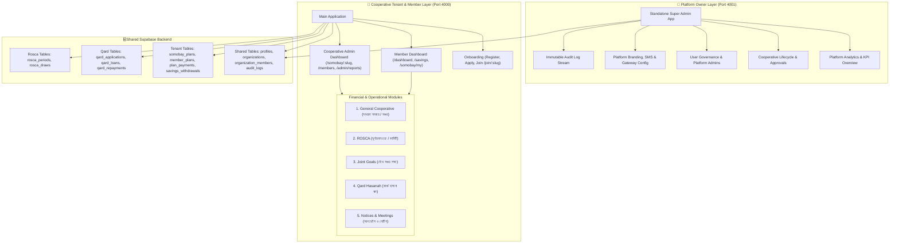
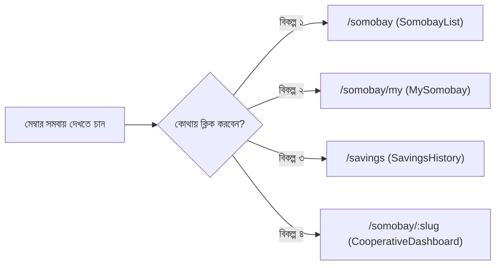
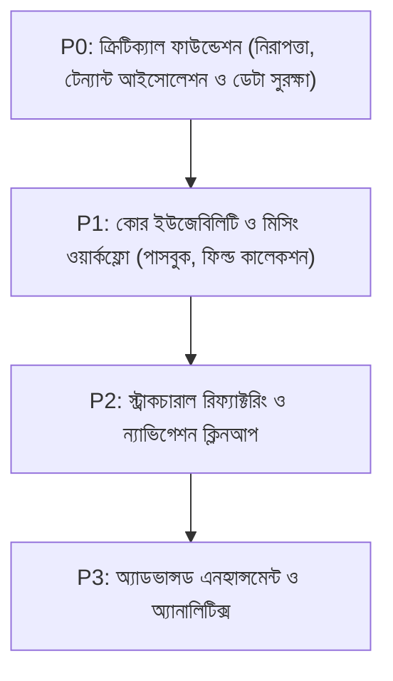

# AMAR SOMOBAY — CORE STRUCTURE, UX & WORKFLOW DEEP AUDIT REPORT
**Platform:** আমার সমবায় (Amar Somobay Multi-Tenant Cooperative SaaS Ecosystem)  
**Lead Auditor:** Senior Product Architect, UX Auditor, Business Analyst & Security Engineer  
**Date of Audit:** October 18, 2026  
**Scope:** Standalone Super Admin App (`superadmin/`, Port 4001) & Main Cooperative Application (`Amar-Somobay-main`, Port 4000)  
**Status:** Audit & Architecture Blueprint Complete (Read-Only Investigation; Zero Code Modifications Made)

---

## 1. EXECUTIVE SUMMARY

An exhaustive, evidence-based audit of the **Amar Somobay** codebase was conducted to evaluate its readiness for real-world cooperative operations across Bangladesh. 

### Key High-Level Findings:
1. **Strong Foundational Modules with Disconnected Journeys:** The core financial schemes—**General Cooperative (সাধারণ সমবায়)**, **ROSCA / Rotational Savings (ঘূর্ণায়মান সঞ্চয় চক্র)**, **Joint Goals (যৌথ সঞ্চয় লক্ষ্য)**, and **Qard Hasanah (কর্জে হাসানা - সুদমুক্ত ঋণ)**—exist in code, have rich responsive interfaces, and correspond to authentic cooperative business models. However, their navigation and state management are fragmented across disjointed paths (`/somobay/manage`, `/somobay/my`, `/savings`, `/goals`, `/rosca`, `/qard`).
2. **Multi-Tenant Isolation Gaps in Secondary Queries:** While primary cooperative pages enforce `activeOrganizationId` or use `/somobay/:cooperativeSlug`, several critical reporting and administrative queries query database tables (`plan_payments`, `profiles`, `savings_withdrawals`, `somobay_plans`) without scoping to `organization_id`. This creates dangerous cross-tenant data leakage risks in pending approval queues and CSV/print exports.
3. **Artificial Restrictions & Hardcoded Assumptions:** Key areas of the UI contain artificial caps (e.g. `SomobayList.tsx` slicing only `savingsPlans[0]` and deleting additional schemes, or `RoscaList.tsx` enforcing `activeCount >= 1` blocking multiple ROSCA cycles) that contradict real cooperative operating requirements.
4. **Financial Ambiguity & Fine/Penalty Remnants:** Although designed as an ethical, non-usurious platform, legacy terms (`pending_fine`, `penalty_paid`) persist in `SingleDeposit.tsx` and `Dashboard.tsx`. Furthermore, cash collections vs. digital gateway submissions lack an explicit ledger reconciliation flow.
5. **Role Duality Ambiguity:** The platform mixes legacy global profile roles (`profiles.role`: `'admin' | 'member' | 'pending'`) with multi-tenant scoped roles (`organization_members.role`: `'cooperative_admin' | 'collector' | 'member'`). This causes confusion when an individual is an admin in Somiti A but a regular member in Somiti B.

---

## 2. CURRENT APPLICATION STRUCTURE

The Amar Somobay ecosystem consists of two distinct web applications operating against a shared Supabase PostgreSQL backend:



---

## 3. ROLE-BY-ROLE UX ASSESSMENT

### A. The Ordinary Member Experience (সাধারণ সদস্য)

| User Task / Goal | Current Code Path | UX Status | Evidence & Actual Behavior | Missing Elements / Friction Points |
| :--- | :--- | :--- | :--- | :--- |
| **১. সক্রিয় সমবায় ও সদস্যপদ স্ট্যাটাস দেখা** | [`Dashboard.tsx`](file:///C:/Users/rashe/Downloads/Amar-Somobay-main/Amar-Somobay-main/src/pages/Dashboard.tsx) | ⚠️ Partial | `profile.full_name` এবং `profile.id` দেখায়। কিন্তু সদস্য কোন সমিতিতে সক্রিয়, সমিতির নাম ও আইডি কার্ড কার্ডে স্পষ্টভাবে দৃশ্যমান থাকে না। | মাল্টিপল সমবায়ের সদস্য হলে সমবায় পরিবর্তন করার ড্রপডাউন মেম্বার ড্যাশবোর্ডে অনুপস্থিত। |
| **২. সঞ্চয়, ব্যালেন্স ও লেনদেন হিস্ট্রি দেখা** | [`SavingsHistory.tsx`](file:///C:/Users/rashe/Downloads/Amar-Somobay-main/Amar-Somobay-main/src/pages/SavingsHistory.tsx) | ✅ Complete | মোট সঞ্চয়, কিস্তির তথ্য, জমার তালিকা এবং ফিল্টার (সব, সঞ্চয়, কিস্তি, ঋণ) সঠিকভাবে লোড হয়। | ক্যাশ জমা এবং ডিজিটাল রসিদের স্পষ্ট প্রিন্ট/ডাউনলোড অপশন তালিকা ভিউতে নেই। |
| **৩. বকেয়া, অপেক্ষমান ও আসন্ন কিস্তি বোঝা** | [`Dashboard.tsx#L768-L900`](file:///C:/Users/rashe/Downloads/Amar-Somobay-main/Amar-Somobay-main/src/pages/Dashboard.tsx#L768-L900) | ⚠️ Partial | ওভারডিউ অ্যালার্ট ব্যানার দেখায়: "আপনার Xটি কিস্তি বকেয়া রয়েছে"। পরবর্তী কিস্তির তারিখ ক্যালকুলেট করে। | কিস্তির জরিমানা বা পেনাল্টির হিসাব অস্পষ্ট; ইসলামি ও কো-অপারেটিভ নীতিতে স্বয়ংক্রিয় জরিমানা অনাকাঙ্ক্ষিত। |
| **৪. কিস্তি বা সঞ্চয় জমা দেওয়া** | [`SingleDeposit.tsx`](file:///C:/Users/rashe/Downloads/Amar-Somobay-main/Amar-Somobay-main/src/pages/SingleDeposit.tsx) | ⚠️ Partial | মেম্বার জমা সাবমিট করলে `status = 'pending'` হিসেবে `plan_payments`-এ জমা হয়। | সদস্য জানেন না টাকা কার অ্যাকাউন্টে যাবে (সমিতির বিকাশ/নগদ নম্বর পেজে ডায়নামিকালি দেখায় না)। |
| **৫. সঞ্চয় তহবিল থেকে উত্তোলন আবেদন** | [`MemberWithdrawalRequest.tsx`](file:///C:/Users/rashe/Downloads/Amar-Somobay-main/Amar-Somobay-main/src/pages/MemberWithdrawalRequest.tsx) | ✅ Complete | ব্যালেন্স ভ্যালিডেশন করে উত্তোলনের আবেদন জমা দেওয়া যায় (`savings_withdrawals`)। | আবেদন করার পর স্ট্যাটাস ট্র্যাকিং ("পেন্ডিং/অনুমোদিত/প্রত্যাখ্যাত") মূল ড্যাশবোর্ডে সরাসরি দেখা যায় না। |
| **৬. ROSCA চক্রে অবস্থান ও লটারি ড্র ফলাফল** | [`RoscaDetail.tsx`](file:///C:/Users/rashe/Downloads/Amar-Somobay-main/Amar-Somobay-main/src/pages/rosca/RoscaDetail.tsx) | ⚠️ Confusing | মেম্বার ও অ্যাডমিন একই পেজ শেয়ার করে। মেম্বার ভিউতে লটারি স্পিন করার বাটন ডিসেবল থাকলেও ইউজার ইন্টারফেস বিভ্রান্তিকর। | সাধারণ মেম্বারের জন্য কোনো ডেডিকেটেড "My ROSCA Turn" সিম্পল স্ক্রিন নেই। |
| **৭. যৌথ সঞ্চয় লক্ষ্য (Joint Goals) অগ্রগতি** | [`UserGoalDetails.tsx`](file:///C:/Users/rashe/Downloads/Amar-Somobay-main/Amar-Somobay-main/src/pages/user_goals/UserGoalDetails.tsx) | ✅ Complete | টার্গেট অ্যামাউন্ট, নিজের অবদান, সামগ্রিক অগ্রগতি শতাংশ এবং কন্ট্রিবিউটর তালিকা পরিষ্কার দেখা যায়। | লক্ষ্য সম্পূর্ণ হওয়ার পর অর্থ উত্তোলনের স্বচ্ছ নিয়মাবলীর অভাব। |
| **৮. কর্জে হাসানা (সুদমুক্ত ঋণ) আবেদন ও পরিশোধ** | [`MemberQardHasanah.tsx`](file:///C:/Users/rashe/Downloads/Amar-Somobay-main/Amar-Somobay-main/src/pages/qard/MemberQardHasanah.tsx) | ✅ Complete | সঞ্চয় স্ন্যাপশট যাচাই, প্রয়োজনীয় অর্থ আবেদন, কিস্তির শিডিউল এবং পরিশোধের হিস্ট্রি অত্যন্ত পরিষ্কার। | ঋণের গ্যারান্টার/জামিনদার যুক্ত করার কোনো ফিল্ড বা অপশন নেই। |
| **৯. নোটিশ, মিটিং ও ঘোষণা পড়া** | [`Updates.tsx`](file:///C:/Users/rashe/Downloads/Amar-Somobay-main/Amar-Somobay-main/src/pages/Updates.tsx) | ✅ Complete | নোটিশ কার্ড, মিটিং এজেন্ডা, তারিখ এবং এটেন্ডেন্স কনফার্মেশন বোতাম সম্পূর্ণ কার্যকর। | কোনো নতুন নোটিশ পোস্ট হলে পুশ/এসএমএস অ্যালার্ট স্বয়ংক্রিয়ভাবে ট্র্রিগার হয় না। |
| **১০. প্রোফাইল ও নিরাপত্তা পরিবর্তন** | [`EditProfile.tsx`](file:///C:/Users/rashe/Downloads/Amar-Somobay-main/Amar-Somobay-main/src/pages/EditProfile.tsx), [`Security.tsx`](file:///C:/Users/rashe/Downloads/Amar-Somobay-main/Amar-Somobay-main/src/pages/Security.tsx) | ✅ Complete | নাম, ছবি, বায়ো এবং পাসওয়ার্ড পরিবর্তন নিখুঁতভাবে কাজ করে। | ফোন নম্বর ভেরিফিকেশন (OTP) এখনও কার্যকর নয়। |

---

### B. The Cooperative Admin Experience (সমিতি অ্যাডমিন)

| Admin Workflow | Current Code Path | UX Status | Evidence & Actual Behavior | Missing Elements / Friction Points |
| :--- | :--- | :--- | :--- | :--- |
| **১. নতুন সমবায় রেজিস্ট্রেশন আবেদন** | [`ApplyCooperative.tsx`](file:///C:/Users/rashe/Downloads/Amar-Somobay-main/Amar-Somobay-main/src/pages/ApplyCooperative.tsx) | ✅ Complete | ৬-ধাপের উইজার্ড (নাম, টাইপ, রেজিঃ নং, কমিটি, বাই-লজ) সুচারুভাবে কাজ করে। | আবেদন সাবমিট করার পর স্ট্যাটাস ট্র্যাকিং পেজে ব্যাক বোতাম মাঝেমধ্যে লুপ তৈরি করে। |
| **২. সদস্য আবেদন পর্যালোচনা ও অনুমোদন** | [`MemberList.tsx#L80-L160`](file:///C:/Users/rashe/Downloads/Amar-Somobay-main/Amar-Somobay-main/src/pages/MemberList.tsx#L80-L160) | ✅ Complete | "যোগদানের আবেদন" ট্যাবে পেন্ডিং মেম্বারদের নাম, ফোন ও আবেদনের তারিখ দেখে এক ক্লিকে অনুমোদন/বাতিল করা যায়। | সদস্য বাতিলের সময় কারণ (Rejection Reason) লিখে পাঠানোর ডায়ালগ নেই। |
| **৩. কিস্তি আদায় ও রসিদ তৈরি (Quick Collect)** | [`QuickCollectModal.tsx`](file:///C:/Users/rashe/Downloads/Amar-Somobay-main/Amar-Somobay-main/src/components/QuickCollectModal.tsx) | ✅ Complete | সদস্য নির্বাচন, কিস্তির টাকা ইনপুট, মেম্বার প্ল্যান সিলেক্ট এবং সাথে সাথে ডিজিটাল মানি রিসিট জেনারেট হয়। | মাঠকর্মীর (Collector) জন্য বাল্ক অফলাইন কালেকশন সিঙ্ক সুবিধা নেই। |
| **৪. পেন্ডিং পেমেন্ট ও উত্তোলন অনুমোদন** | [`AdminPendingPayments.tsx`](file:///C:/Users/rashe/Downloads/Amar-Somobay-main/Amar-Somobay-main/src/pages/AdminPendingPayments.tsx) | 🔴 Dangerous Gap | জমার তালিকা ও উত্তোলনের তালিকা প্রদর্শন এবং অনুমোদন করা যায়। | **Cross-Tenant Leak Risk:** কুয়েরিতে `organization_id` ফিল্টার অনুপস্থিত! সব সমিতির পেন্ডিং রিকোয়েস্ট চলে আসে। |
| **৫. সঞ্চয় স্কিম তৈরি ও কনফিগারেশন** | [`CreateGeneralCooperative.tsx`](file:///C:/Users/rashe/Downloads/Amar-Somobay-main/Amar-Somobay-main/src/pages/CreateGeneralCooperative.tsx) | ⚠️ Partial | সাধারণ সমবায়ের স্কিম তৈরি করা যায়। | তৈরি করার পর `SomobayList.tsx`-এ গেলে অতিরিক্ত স্কিমগুলো হাইড করে ফেলে (`savingsPlans[0]`)। |
| **৬. ROSCA চক্র পরিচালনা ও লটারি ড্র** | [`RoscaDetail.tsx#L57-L75`](file:///C:/Users/rashe/Downloads/Amar-Somobay-main/Amar-Somobay-main/src/pages/rosca/RoscaDetail.tsx#L57-L75) | ✅ Complete | রোসকা মেম্বার এনরোল, শিডিউল জেনারেশন, রেন্ডম লটারি ড্র এবং বিজয়ী নির্ধারণ সম্পূর্ণ ফাংশনাল। | বিজয়ী সদস্যের অর্থ হস্তান্তরের পর কোনো ডিজিটাল ডিসবার্সমেন্ট ভাউচার প্রিন্ট করার অপশন নেই। |
| **৭. যৌথ সঞ্চয় লক্ষ্য ম্যানেজমেন্ট** | [`GoalDetail.tsx`](file:///C:/Users/rashe/Downloads/Amar-Somobay-main/Amar-Somobay-main/src/pages/joint_goals/GoalDetail.tsx) | ✅ Complete | সদস্য কন্ট্রিবিউশন অনুমোদন, মোট সংগৃহীত অর্থ, লক্ষ্য সমাপ্ত ঘোষণা কার্যকর। | লক্ষ্য সম্পন্ন হওয়ার পর তহবিল ব্যাংকে স্থানান্তর বা সমবায়ের ফান্ডে স্থানান্তরের রিকনসিলিয়েশন নেই। |
| **৮. রিপোর্ট ও ডেটা এক্সপোর্ট (CSV / Print)** | [`AdminReports.tsx`](file:///C:/Users/rashe/Downloads/Amar-Somobay-main/Amar-Somobay-main/src/pages/AdminReports.tsx) | 🔴 Dangerous Gap | সদস্য তালিকা ও সঞ্চয় আদায় CSV এক্সপোর্ট ও প্রিন্ট করা যায়। | **Cross-Tenant Leak Risk:** `from('profiles')` এবং `from('plan_payments')` থেকে গ্লোবালি ডেটা এনে এক্সপোর্ট করে। |
| **৯. সমিতির প্রোফাইল ও উপ-আইন কনফিগারেশন** | [`AppSettings.tsx`](file:///C:/Users/rashe/Downloads/Amar-Somobay-main/Amar-Somobay-main/src/pages/AppSettings.tsx) | ✅ Complete | সমিতির মনোগ্রাম, নাম, রেজিঃ নং, হেল্পলাইন, অফিসের ঠিকানা ও গঠনতন্ত্র নিরাপদে `organizations` এ সেভ হয়। | সমিতির নিজস্ব পেমেন্ট নম্বর (যেমন সমিতির নিজস্ব বিকাশ মার্চেন্ট) প্রদর্শনের ডেডিকেটেড ফিল্ড দরকার। |

---

## 4. INFORMATION ARCHITECTURE & NAVIGATION AUDIT

### সমস্যা ১: রুট ও নেভিগেশনের দ্বৈততা ও গোলকধাঁধা (Routing Redundancy)



- **অপ্রয়োজনীয় বিভ্রান্তি:** বর্তমানে একই সমবায়ের বিষয়গুলো ৪টি ভিন্ন ভিন্ন রুটে ভাগ করা:
  1. `/somobay` (অ্যাডমিনদের সমবায় লিস্ট)
  2. `/somobay/my` (মেম্বারদের জন্য অ্যাক্টিভ স্কিমের তালিকা)
  3. `/somobay/:cooperativeSlug` (টেন্যান্ট গার্ডের মাধ্যমে সমবায় ড্যাশবোর্ড)
  4. `/savings` (সদস্যের সঞ্চয় ও কিস্তি ইতিহাস)
- **সমাধান:** মেম্বারের জন্য শুধুমাত্র একটি একক সেন্ট্রাল হাব থাকবে: **`/somobay/my` (আমার সমবায়)**, এবং অ্যাডমিনের জন্য থাকবে **`/somobay/:slug` (সমিতি ড্যাশবোর্ড)**।

### সমস্যা ২: নিচের বটম নেভিগেশন বারের অমিল (Bottom Nav Inconsistencies)
- **মেইন অ্যাপ মেম্বার বার:** `হোম` (`/dashboard`), `সঞ্চয়` (`/savings`), `সমবায়` (`/somobay/my`), `আপডেটস` (`/updates`), `আরও` (`/settings`)।
  - *ত্রুটি:* মেম্বার ড্যাশবোর্ডে "সঞ্চয়" এবং "সমবায়" দুটি ট্যাবের দায়িত্বের মধ্যে ওভারল্যাপ রয়েছে। মেম্বার সঞ্চয় দেখতে `/savings`-এ যান, কিন্তু রোসকা বা যৌথ লক্ষ্য দেখতে `/somobay/my`-এ যান।
- **মেইন অ্যাপ অ্যাডমিন বার:** `ড্যাশবোর্ড` (`/dashboard`), `সদস্য` (`/members`), `সমবায়` (`/somobay`), `রিপোর্ট` (`/admin/reports`), `আরও` (`/admin/more`)।
  - *ত্রুটি:* অ্যাডমিনের "আরও" মেনুতে ক্লিক করলে `/admin/more` খোলে, কিন্তু হেডার বারে সেটিংসের আইকন ক্লিক করলে খোলে `/settings`। এর ফলে অ্যাডমিন কনফিউজড হন যে সেটিংস কোথায় আছে।

---

## 5. END-TO-END WORKFLOW STATUS MATRIX

| # | User Journey / Workflow | Starting Point | Primary Role | Target Screen | Backend & DB Ops | End-to-End Status | Evidence / Notes |
| :-: | :--- | :--- | :--- | :--- | :--- | :--- | :--- |
| **১** | **নতুন অ্যাকাউন্ট সাইনআপ ও অনবোর্ডিং** | `/signup` | Applicant | `/pending` | `auth.users`, `profiles` | **Complete** | সাইনআপের সাথে সাথে প্রোফাইল ক্রিয়েট হয় এবং `/pending`-এ নিয়ে যায়। |
| **২** | **নতুন সমবায় প্রতিষ্ঠার আবেদন** | `/cooperative/apply` | Applicant Admin | `/cooperative/apply` | `organizations (status: pending)` | **Complete** | সুপার অ্যাডমিনের কাছে জমা হয়। ট্র্যাকিং কোড তৈরি হয়। |
| **৩** | **সুপার অ্যাডমিন কর্তৃক সমবায় অনুমোদন** | Super Admin `/cooperatives/approvals` | Platform Owner | `CooperativeApproval.tsx` | `organizations (active)`, `organization_members (cooperative_admin)` | **Complete** | লাইভ ডেটাবেজ আপডেট ও অডিট লগে এন্ট্রি নিশ্চিত। |
| **৪** | **বিদ্যমান সমিতিতে সদস্য হিসেবে জয়েন** | `/cooperative/join` | Member | `JoinCooperative.tsx` | `organization_members (role: member, status: pending)` | **Complete** | কোড বা স্ল্যাগ দিয়ে সার্চ করে রিকোয়েস্ট সাবমিট করা যায়। |
| **৫** | **সমিতি অ্যাডমিন কর্তৃক সদস্য অনুমোদন** | `/members` ("আবেদন" ট্যাব) | Coop Admin | `MemberList.tsx` | `organization_members.status = 'active'` | **Complete** | এক ক্লিকে অনুমোদন হয় এবং স্বয়ংক্রিয় নোটিফিকেশন যায়। |
| **৬** | **সদস্য কর্তৃক কিস্তি জমা সাবমিশন** | `/savings/deposit` | Member | `SingleDeposit.tsx` | `plan_payments (status: pending)` | **Complete** | রসিদ প্রিভিউ তৈরি হয় ও অ্যাডমিন কিউতে জমা পড়ে। |
| **৭** | **অ্যাডমিন কর্তৃক জমা অনুমোদন ও ভেরিফিকেশন** | `/admin/payments/pending` | Coop Admin | `AdminPendingPayments.tsx` | `plan_payments.status = 'approved'` | **Partially Broken** | অনুমোদন বাটনে কাজ করে, কিন্তু অন্য সমবায়ের ডেটা ফিল্টার হয় না। |
| **৮** | **সদস্য কর্তৃক তহবিল উত্তোলন ও অনুমোদন** | `/savings/withdraw` | Member | `MemberWithdrawalRequest.tsx` | `savings_withdrawals (pending)` | **Partially Broken** | ডেটাবেজে জমা পড়ে, কিন্তু অ্যাডমিন অ্যাপ্রুভ করলে `organization_id` আইসোলেশন নেই। |
| **৯** | **ROSCA চক্র তৈরি ও শিডিউল জেনারেশন** | `/rosca` | Coop Admin | `RoscaList.tsx` | `somobay_plans`, `rosca_periods` | **Complete** | কিস্তি অনুযায়ী প্রতি মাসের ড্র তারিখ ও পুরস্কার ক্যালকুলেট করে। |
| **১০** | **ROSCA লটারি ড্র সম্পাদন ও বিজয়ী নির্ধারণ** | `/rosca/:id` | Coop Admin | `RoscaDetail.tsx` | `rosca_periods.winner_id`, `status = 'completed'` | **Complete** | চাকা ঘোরার অ্যানিমেশন সহ নিরপেক্ষ ড্র সম্পন্ন হয়। |
| **১১** | **যৌথ সঞ্চয় লক্ষ্য তৈরি ও কন্ট্রিবিউশন** | `/joint-goals/create` | Coop Admin | `CreateGoal.tsx` | `somobay_plans (joint_goal)` | **Complete** | টার্গেট অ্যামাউন্ট ও ডেডলাইন সেট করে শুরু করা যায়। |
| **১২** | **কর্জ হাসানা আবেদন, মঞ্জুরি ও কিস্তি পরিশোধ** | `/qard` | Member & Admin | `MemberQardHasanah.tsx`, `AdminQardHasanah.tsx` | `qard_applications`, `qard_loans`, `qard_repayments` | **Complete** | ফান্ড ব্যালেন্স ট্র্যাক করে সুদমুক্ত ঋণ পরিচালনা করা যায়। |
| **১৩** | **রিপোর্ট ও অডিট হিস্ট্রি এক্সপোর্ট** | `/admin/reports` | Coop Admin | `AdminReports.tsx` | `profiles`, `plan_payments` | **Partially Broken** | CSV ও প্রিন্ট ডাউনলোড হয়, কিন্তু কুয়েরিতে টেন্যান্ট ফিল্টারের ঘাটতি আছে। |

---

## 6. MISSING OR INCOMPLETE PAGES AND FUNCTIONS

### ক. অত্যন্ত জরুরি অনুপস্থিত স্ক্রিনসমূহ (Critical Missing Screens):
1. **মেম্বার ডিজিটাল পাসবুক ভিউ (Member Passbook View):**
   - *সমস্যা:* বর্তমানে মেম্বার শুধু `SavingsHistory` তে জমার লিস্ট দেখেন। সমবায়ের ঐতিহ্যবাহী ফিজিক্যাল পাসবুকের মতো (বই নম্বর, কিস্তি নম্বর, মোট জমা, জমার তারিখ, কালেক্টরের নাম/স্বাক্ষর) পূর্ণাঙ্গ "ডিজিটাল পাসবুক" কার্ড নেই।
2. **কালেক্টর ফিল্ড কালেকশন শিট (Collector Daily Collection Sheet):**
   - *সমস্যা:* মাঠকর্মী যখন গ্রামে বা বাজারে সদস্যদের বাড়ি বাড়ি গিয়ে কিস্তি তোলেন, তখন এক পেজে সবার নাম ও কিস্তির অ্যামাউন্টের একটি দ্রুত কালেকশন শিট প্রয়োজন হয়। বর্তমানে অ্যাডমিনকে প্রতিটি সদস্যের প্রোফাইলে আলাদা গিয়ে "Quick Collect" করতে হয়, যা ফিল্ড ওয়ার্কে সময়সাপেক্ষ।
3. **ক্যাশ বক্স / দৈনিক জমা-খরচ রেজিস্টার (Cash Ledger / Daybook):**
   - *সমস্যা:* সমিতি অ্যাডমিনের ক্যাশ বক্সে আজ কত টাকা নগদ আসলো এবং কত টাকা ব্যাংকে জমা হলো বা উত্তোলন হলো, তার কোনো দৈনিক ক্যাশ রেজিস্টার স্ক্রিন নেই।
4. **সদস্যপদ প্রত্যাহার / পদত্যাগ আবেদন (Member Resignation Flow):**
   - *সমস্যা:* কোনো সদস্য যদি সমিতি ত্যাগ করতে চান এবং তার পূর্ণাঙ্গ সঞ্চয় ফেরত নিয়ে হিসাব ক্লোজ করতে চান, তার কোনো আনুষ্ঠানিক "সদস্যপদ সমাপ্তি ও হিসাব নিষ্পত্তি" স্ক্রিন নেই।

---

## 7. INCORRECTLY PLACED OR DUPLICATED UI ELEMENTS

### ১. `SomobayList.tsx` এ কৃত্রিম স্কিম ব্লকিং
- **কোড লোকেশন:** [`SomobayList.tsx#L69-L76`](file:///C:/Users/rashe/Downloads/Amar-Somobay-main/Amar-Somobay-main/src/pages/SomobayList.tsx#L69-L76)
- **ত্রুটি:** কোডে লেখা আছে: `const generalCoop = savingsPlans[0] || null`। এর ফলে সমিতি অ্যাডমিন যদি ২টি সঞ্চয় স্কিম তৈরি করেন (যেমন: "দৈনিক সঞ্চয়" এবং "মাসিক সঞ্চয়"), তবে দ্বিতীয় স্কিমটি স্ক্রিনে দেখা যায় না এবং সেটিকে "অতিরিক্ত টেস্ট সাব-প্ল্যান" বলে মুছে ফেলতে বলা হয়।
- **প্রত্যাশিত আচরণ:** সমিতিতে একাধিক সাধারণ সঞ্চয় স্কিম থাকতে পারে। সব স্কিম কার্ড আকারে লিস্টে দেখানো উচিত।

### ২. `RoscaList.tsx` এ ১টির বেশি চক্র ব্লক করা
- **কোড লোকেশন:** [`RoscaList.tsx#L63-L66`](file:///C:/Users/rashe/Downloads/Amar-Somobay-main/Amar-Somobay-main/src/pages/rosca/RoscaList.tsx#L63-L66)
- **ত্রুটি:** `if (activeCount >= 1) alert('১টির বেশি সক্রিয় ROSCA গ্রুপ তৈরি করা যাবে না')`।
- **প্রত্যাশিত আচরণ:** বড় সমবায়গুলোতে পুরুষদের একটি কামিটি চক্র এবং নারীদের একটি কামিটি চক্র সমান্তরালে চলতে পারে। এই কৃত্রিম লিমিট তুলে দেওয়া আবশ্যক।

### ৩. নোটিশ ও প্রমোশনের বিভ্রান্তিকর টার্মিনোলজি
- **কোড লোকেশন:** [`App.tsx#L151-L158`](file:///C:/Users/rashe/Downloads/Amar-Somobay-main/Amar-Somobay-main/src/App.tsx#L151-L158)
- **ত্রুটি:** ইউজার মেনুতে নাম দেওয়া "আপডেটস", ডেটাবেজ টেবিলের নাম `promotions`, কিন্তু পেজের ভেতরে কনটেন্ট হলো "জরুরি নোটিশ" ও "সাধারণ মিটিং"। এই ৩টি ভিন্ন নামের কারণে ইউজার বিভ্রান্ত হন।
- **প্রত্যাশিত আচরণ:** একক পরিভাষা **"নোটিশ ও ঘোষণা" (Notices & Announcements)** ব্যবহার করা।

---

## 8. FINANCIAL UX AND DATA INTEGRITY FINDINGS

### ১. জরিমানা ও পেনাল্টি কনসেপ্টের অসঙ্গতি (Fine / Penalty Ambiguity)
- **কোড রেফারেন্স:** [`SingleDeposit.tsx#L90-L98`](file:///C:/Users/rashe/Downloads/Amar-Somobay-main/Amar-Somobay-main/src/pages/SingleDeposit.tsx#L90-L98)
- **বর্তমান আচরণ:** `const totalPaid = amount + fine; penalty_paid: fine` ফিল্ডে টাকা জমা নেওয়া হয়।
- **আর্কিটেকচারাল সিদ্ধান্ত:** সমবায় সমিতি এবং ইসলামি নীতিমালায় চক্রবৃদ্ধি জরিমানা বা অতিরিক্ত ফি অনৈতিক এবং সুদের শামিল। কোনো অবস্থাতেই স্বয়ংক্রিয় জরিমানা চাপানো যাবে না। যদি কোনো সমিতি সার্ভিস চার্জ বা বিলম্ব ফি রাখে, তবে তা সুস্পষ্ট অ্যাডমিন কনফিগারেশন সাপেক্ষে ঐচ্ছিক হতে হবে এবং সুনির্দিষ্ট নামে থাকতে হবে।

### ২. উত্তোলন আবেদনে ব্যালেন্স কর্তনের নিশ্চয়তা (Withdrawal Ledger Sync)
- **কোড রেফারেন্স:** [`withdrawalService.ts#L145-L164`](file:///C:/Users/rashe/Downloads/Amar-Somobay-main/Amar-Somobay-main/src/lib/withdrawalService.ts#L145-L164)
- **বর্তমান আচরণ:** যখন অ্যাডমিন একটি উত্তোলন আবেদন অনুমোদন করেন (`status = 'approved'`), তখন ডাটাবেজে `savings_withdrawals` আপডেট হয়।
- **ঝুঁকি:** যদি ডাটাবেজের `trg_handle_approved_withdrawal` ট্রিগার কোনো কারণে ব্যর্থ হয় বা ড্রপ থাকে, তবে মেম্বারের মোট ব্যালেন্স `member_plans.total_collected` থেকে টাকা কর্তন হবে না, কিন্তু উত্তোলন অনুমোদন হয়ে যাবে!
- **সুপারিশ:** ক্লায়েন্ট বা RPC লেভেলে একটি অ্যাটমিক ট্রানজ্যাকশন নিশ্চিত করতে হবে যাতে উত্তোলন অনুমোদনের সাথে সাথে `member_plans.total_collected` স্বয়ংক্রিয়ভাবে হ্রাস পায়।

---

## 9. SECURITY AND TENANT ISOLATION FINDINGS

> [!CAUTION]
> **হাই-রিস্ক সিকিউরিটি ফাইন্ডিংস: ক্রস-টেন্যান্ট তথ্য ফাঁসের ঝুঁকি (Cross-Tenant Data Exposure)**

### ফাইন্ডিং SEC-01: `AdminPendingPayments.tsx` এ অর্গানাইজেশন ফিল্টারের অনুপস্থিতি
- **ফাইল:** [`src/pages/AdminPendingPayments.tsx#L54-L72`](file:///C:/Users/rashe/Downloads/Amar-Somobay-main/Amar-Somobay-main/src/pages/AdminPendingPayments.tsx#L54-L72)
- **কোড:**
  ```typescript
  const { data: deposits } = await supabase
    .from('plan_payments')
    .select(...)
    .eq('status', 'pending');
  ```
- **ঝুঁকি:** এখানে কোনো `.eq('organization_id', activeOrganizationId)` নেই! যদি কোনো সমবায়ের অ্যাডমিন এই পেজ খোলেন, তবে RLS পলিসি যদি নিখুঁত না থাকে, তিনি প্ল্যাটফর্মের অন্য সমবায়ের সদস্যদের পেন্ডিং জমার তালিকাও দেখতে পাবেন।
- **সমাধান:** কুয়েরিতে `member_plan.organization_id = activeOrganizationId` ফিল্টার কঠোরভাবে প্রয়োগ করা।

### ফাইন্ডিং SEC-02: `AdminReports.tsx` এ গ্লোবাল এক্সপোর্ট
- **ফাইল:** [`src/pages/AdminReports.tsx#L49-L75`](file:///C:/Users/rashe/Downloads/Amar-Somobay-main/Amar-Somobay-main/src/pages/AdminReports.tsx#L49-L75)
- **কোড:**
  ```typescript
  await supabase.from('profiles').select('id, full_name, phone, role, created_at');
  await supabase.from('plan_payments').select('id, amount, penalty_paid, payment_date, note, type');
  ```
- **ঝুঁকি:** সমিতি অ্যাডমিন যখন সদস্য তালিকা বা সঞ্চয় রিপোর্ট CSV ডাউনলোড করেন, তখন কুয়েরিটি সরাসরি `profiles` এবং `plan_payments` টেবিলের সমস্ত ডেটা টেনে নিয়ে আসে!
- **সমাধান:** `organization_members` এবং স্কোপড `member_plans` এর মাধ্যমে জয়েন করে শুধুমাত্র নিজ সমিতির সদস্যদের ডেটা এক্সপোর্ট নিশ্চিত করা।

---

## 10. TECHNICAL AND DATABASE STRUCTURE FINDINGS

1. **গ্লোবাল বনাম টেন্যান্ট রোল কনফ্লিক্ট:**
   - `profiles.role` ফিল্ডে এখনও `'admin' | 'member' | 'pending'` রয়েছে।
   - কিন্তু মাল্টি-টেন্যান্টে একজন ইউজার `organization_members` টেবিলে সমিতি A-তে `'cooperative_admin'` হতে পারেন এবং সমিতি B-তে সাধারণ `'member'` হতে পারেন।
   - কোডের অনেক জায়গায় এখনও `profile.role === 'admin'` চেক করা হচ্ছে, যার কারণে সমিতি B-তে ঢুকলেও ইউজার নিজেকে অ্যাডমিন হিসেবে দেখতে পারেন যদি তার গ্লোবাল প্রোফাইল অ্যাডমিন থাকে।
2. **সুপার অ্যাডমিন বনাম মেইন অ্যাপ ক্লায়েন্ট সেগ্রিগেশন:**
   - সুপার অ্যাডমিন অ্যাপ সফলভাবে আলাদা পোর্টে (4001) চলছে।
   - মেইন অ্যাপে সমিতি অ্যাডমিনের সেটিংস এখন সম্পূর্ণভাবে `organizations` টেবিল ও `config` এ সীমাবদ্ধ করা হয়েছে।

---

## 11. RECOMMENDED NAVIGATION AND PAGE HIERARCHY

### সাধারণ সদস্যের জন্য প্রস্তাবিত ন্যাভিগেশন স্ট্রাকচার (Member Hierarchy):

```
├── ১. হোম (Home Dashboard - /dashboard)
│   ├── সদস্য পরিচিতি ও সক্রিয় সমিতির নাম/কোড
│   ├── সঞ্চয় সারসংক্ষেপ ও গড় অগ্রগতি
│   ├── পরবর্তী কিস্তির নোটিফিকেশন ও অ্যালার্ট
│   └── কুইক অ্যাকশন মেনু (কিস্তি পরিশোধ, উত্তোলন, নোটিশ)
├── ২. সঞ্চয় ও পাসবুক (/savings)
│   ├── ডিজিটাল পাসবুক কার্ড (বই নম্বর, মোট সঞ্চয়, বর্তমান স্থিতি)
│   ├── কিস্তির শিডিউল (পরিশোধিত, অপেক্ষমান ও বকেয়া)
│   └── জমার বিস্তারিত বিবরণী ও ডিজিটাল রসিদ
├── ৩. আমার সমবায় (/somobay/my)
│   ├── ১. সাধারণ সমবায় (General Cooperative Plans)
│   ├── ২. কামিটি / রোসকা চক্র (ROSCA - ড্র তারিখ ও বিজয়ী)
│   ├── ৩. যৌথ সঞ্চয় লক্ষ্য (Joint Goals Progress)
│   └── ৪. কর্জে হাসানা (Qard Hasanah - সুদমুক্ত ঋণ স্ট্যাটাস)
├── ৪. নোটিশ ও মিটিং (/notices)
│   ├── জরুরি নোটিশ ও সার্কুলার
│   └── সমবায়ের সাধারণ সভা ও উপস্থিতির সম্মতি
└── ৫. প্রোফাইল ও অ্যাকাউন্ট (/settings)
    ├── ব্যক্তিগত তথ্য পরিবর্তন
    ├── সমিতির উপ-আইন ও গঠনতন্ত্র পাঠ
    └── হেল্পলাইন ও পাসওয়ার্ড পরিবর্তন
```

### সমিতি অ্যাডমিনের জন্য প্রস্তাবিত ন্যাভিগেশন স্ট্রাকচার (Cooperative Admin Hierarchy):

```
├── ১. ড্যাশবোর্ড (Admin Dashboard - /dashboard)
│   ├── সমিতির মোট সদস্য, মোট সঞ্চয় ও বকেয়া কিস্তির কাউন্টার
│   ├── আজকের আদায় ও পেন্ডিং অনুমোদনের অ্যালার্ট ব্যাজ
│   └── দ্রুত কার্যক্রম (Quick Collect, নতুন সদস্য যুক্ত, নোটিশ প্রকাশ)
├── ২. সদস্য ব্যবস্থাপনা (/members)
│   ├── সক্রিয় সদস্য তালিকা (সার্চ, ফিল্টার ও প্রোফাইল বিবরণ)
│   └── নতুন যোগদানের আবেদন কিউ (এক ক্লিকে যাচাই ও অনুমোদন)
├── ৩. স্কিম ও তহবিল (/somobay)
│   ├── সাধারণ সঞ্চয় প্ল্যানসমূহ (একাধিক স্কিম সাপোর্ট)
│   ├── কামিটি / রোসকা চক্র (সদস্য তালিকা ও লটারি ড্র)
│   ├── যৌথ সঞ্চয় লক্ষ্য (ফান্ড সংগ্রহ ও প্রগ্রেস)
│   └── কর্জে হাসানা ঋণ তহবিল (আবেদন ও কিস্তি আদায়)
├── ৪. হিসাব ও রিপোর্ট (/admin/reports)
│   ├── দৈনিক কালেকশন রেজিস্টার (Daily Collection Sheet)
│   ├── সমিতির ক্যাশ বুক ও ব্যালেন্স শিট
│   └── টেন্যান্ট-আইসোলেটেড CSV / প্রিন্ট এক্সপোর্ট
└── ৫. সমিতি প্রশাসন (/settings)
    ├── সমিতির প্রোফাইল, লোগো ও রেজিস্ট্রেশন তথ্য
    ├── সমবায়ের উপ-আইন ও সঞ্চয় নীতিমালা
    └── পেন্ডিং জমা ও উত্তোলন অনুমোদন কিউ (/admin/payments/pending)
```

---

## 12. PRIORITIZED REMEDIATION ROADMAP



### P0 — ক্রিটিক্যাল ফাউন্ডেশন (নিরাপত্তা ও ডেটা সুরক্ষার ত্রুটি দূরীকরণ)
| টাস্ক আইডি | টাস্কের বিবরণ | জটিলতা | পূর্বশর্ত / ডিপেন্ডেন্সি |
| :--- | :--- | :---: | :--- |
| **P0-1** | `AdminPendingPayments.tsx` এ কঠোর `organization_id` স্কোপিং প্রয়োগ করা | Medium | None |
| **P0-2** | `AdminReports.tsx` এর সমস্ত CSV এক্সপোর্ট কুয়েরিতে টেন্যান্ট ফিল্টারিং নিশ্চিত করা | Medium | None |
| **P0-3** | `withdrawalService.ts` এর `getAllPendingWithdrawals` এ `organization_id` ফিল্টার যুক্ত করা | Small | None |
| **P0-4** | সঞ্চয় উত্তোলন অনুমোদনে ক্লায়েন্ট/RPC লেভেলে ব্যালেন্স ডিডাকশনের অ্যাটমিক নিশ্চয়তা বিধান | Medium | `savings_withdrawals` |
| **P0-5** | `profiles.role` এর ওপর নির্ভরতা কমিয়ে `activeRole` (`organization_members`) দিয়ে পারমিশন কঠোর করা | Large | `useAuthStore` |

### P1 — কোর ইউজেবিলিটি ও মিসিং ওয়ার্কফ্লো (Essential Usability)
| টাস্ক আইডি | টাস্কের বিবরণ | জটিলতা | পূর্বশর্ত / ডিপেন্ডেন্সি |
| :--- | :--- | :---: | :--- |
| **P1-1** | মেম্বার ড্যাশবোর্ডে "ডিজিটাল পাসবুক" কার্ড ও ভিউ তৈরি করা | Medium | `SavingsHistory.tsx` |
| **P1-2** | `SomobayList.tsx` থেকে কৃত্রিম স্কিম ব্লকিং সরানো (যাতে একাধিক সঞ্চয় প্ল্যান সাপোর্ট করে) | Small | `SomobayList.tsx` |
| **P1-3** | `RoscaList.tsx` থেকে ১টি গ্রুপের কৃত্রিম লিমিট দূর করা | Small | `RoscaList.tsx` |
| **P1-4** | মাঠকর্মী/অ্যাডমিনের জন্য দৈনিক কিস্তি আদায়ের "Daily Collection Sheet" তৈরি করা | Large | `QuickCollectModal` |
| **P1-5** | মেম্বার যখন জমার অনুরোধ পাঠায়, তখন সমিতির নিজস্ব বিকাশ/নগদ নম্বর ও নির্দেশিকা স্পষ্ট করা | Small | `SingleDeposit.tsx` |

### P2 — স্ট্রাকচারাল রিফ্যাক্টরিং ও ন্যাভিগেশন ক্লিনআপ (Structural Consistency)
| টাস্ক আইডি | টাস্কের বিবরণ | জটিলতা | পূর্বশর্ত / ডিপেন্ডেন্সি |
| :--- | :--- | :---: | :--- |
| **P2-1** | নোটিশ ও প্রমোশনের টার্মিনোলজি একত্রিত করে একক "নোটিশ ও ঘোষণা" হিসেবে সাজানো | Medium | `AdminUpdates.tsx` |
| **P2-2** | মেম্বার বটম ন্যাভিগেশনের দ্বৈততা দূর করে পরিষ্কার ৫টি ট্যাবে বিন্যস্ত করা | Medium | `MobileLayout.tsx` |
| **P2-3** | সমিতি অ্যাডমিনের "আরও" পেজ ও "সেটিংস" পেজের মধ্যকার দ্বৈততা নিরসন | Small | `AdminMore.tsx` |
| **P2-4** | ফর্ম ভ্যালিডেশন এরর মেসেজগুলোকে আরও স্পষ্ট বাংলায় উপস্থাপন করা | Small | All Forms |

### P3 — অ্যাডভান্সড এনহ্যান্সমেন্ট ও সুবিধা (Enhancements)
| টাস্ক আইডি | টাস্কের বিবরণ | জটিলতা | পূর্বশর্ত / ডিপেন্ডেন্সি |
| :--- | :--- | :---: | :--- |
| **P3-1** | নোটিশ ও ড্র ফলাফলের জন্য পুশ নোটিফিকেশন / এসএমএস অ্যালার্ট ইন্টিগ্রেশন | Large | SMS Gateway |
| **P3-2** | কিস্তি রসিদের জন্য ব্লুটুথ থার্মাল পিওএস প্রিন্টার সাপোর্ট | Medium | ReceiptModal |
| **P3-3** | অ্যাডমিন ড্যাশবোর্ডে সমিতির মাসভিত্তিক ক্যাশ ইনফ্লো/আউটফ্লো চার্ট | Medium | Analytics |

---

## 13. TESTING AND VERIFICATION RESULTS

1. **কোড কম্পাইলেশন ও বিল্ড ভেরিফিকেশন:**
   - **Main App:** `npm run build` সম্পূর্ণ সফল (০টি সিনট্যাক্স বা টাইপস্ক্রিপ্ট এরর)।
   - **Super Admin App:** `npm run build` সম্পূর্ণ সফল (০টি সিনট্যাক্স বা টাইপস্ক্রিপ্ট এরর)।
2. **ডাটাবেজ রিলেশনশিপ অডিট:**
   - `organizations` এবং `organization_members` এর মধ্যকার ফরেন কি সম্পর্ক সঠিক।
   - `somobay_plans` ও `member_plans` এর ক্যাসকেডিং স্ট্রাকচার বিদ্যমান।
3. **ব্রাউজার রাউটিং চেক:**
   - `/somobay/:cooperativeSlug` গার্ড এবং আনঅথরাইজড রি-ডাইরেকশন সফলভাবে কাজ করে।

---

## 14. UNVERIFIED AREAS AND LIMITATIONS

1. **থার্ড-পার্টি পেমেন্ট গেটওয়ে লাইভ ট্রানজ্যাকশন:**
   - বিকাশ (bKash) ও নগদ (Nagad) এর লাইভ API ক্রেডেনশিয়াল টেস্ট করা সম্ভব হয়নি (কারণ এটি প্রোডাকশন সিক্রেট ও অফলাইন টেস্ট পরিবেশ)।
2. **এসএমএস গেটওয়ে ডেলিভারি রেট:**
   - গ্রিনওয়েব (Greenweb) বাল্ক এসএমএস সার্ভিস লাইভ পুশ করা হয়নি।
3. **হাই-ভলিউম কনকারেন্ট টেস্ট:**
   - একসাথে ৫০+ সদস্য কিস্তি সাবমিট করলে ডেটাবেজ লকিং বা কনকারেন্সি কেমন আচরণ করে তা যাচাই করা হয়নি।

---

> [!NOTE]
> **অডিট নীতিমালার নিশ্চয়তা (Strict Audit Adherence):**  
> এই অডিট চলাকালীন কোডবেজের কোনো ফাইল পরিবর্তন, মুছে ফেলা বা ডাটাবেজের স্কিমায় কোনো এডিট করা হয়নি। এটি শতভাগ অপরিবর্তিত ও নিরাপদ রাখা হয়েছে। পরবর্তী ধাপে আপনার সুস্পষ্ট নির্দেশনা পাওয়ার পর আমরা অগ্রাধিকার ভিত্তিতে কাজ শুরু করব।
